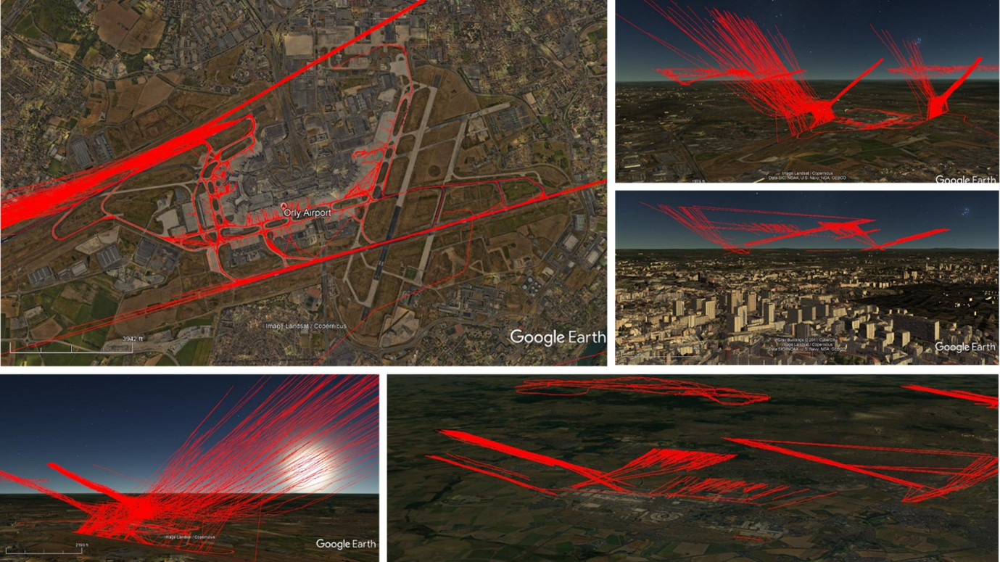
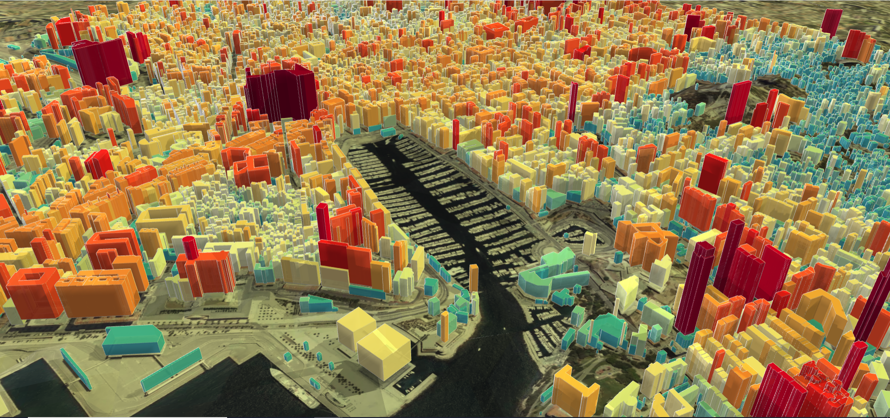

# Expériences

## Développeur SIG
*Depuis Juin 2020*

En tant que développeur SIG au sein de la start-up climatique [Origins-Earth](https://www.origins.earth/notre-demarche), dans le cadre de mon alternance de Master en Géomatique, j'ai eu l'opportunité de participer activement aux projets suivants :

##### 1. Développement d'un module de calcul et spatialisation des émissions de GES du transport aérien

La réalisation de ce projet a eu trois piliers de développement :
- Recherche d'Open Data spatiales et non spatiales notamment liées à:
  - Performance (consommation/émissions) des moteurs en service dans le marché du transporte aerien civile
  - Localisation des pistes d'aéroport dans le monde
  - Trafic aérien
- Création et gestion de la base de données avec PostgreSQL et son extension spatiale PostGIS
- Developpement du module d'automatisation du calcul et spatialisation 3D des trajectoires et des émissions de CO2 avec Python

*💡 Pour ce projet, j’ai dirigé aussi l'installation et le paramétrage d'un récepteur de signal [ADS-B](https://fr.wikipedia.org/wiki/Automatic_dependent_surveillance-broadcast), qui alimente le module de calcul avec des informations sur le trafic aérien.*

| Produits                                                                                                                                                                                                                                                                                                                                                                                                                                              | Langages              | Logiciels et Librairies                                                                 |
| ----------------------------------------------------------------------------------------------------------------------------------------------------------------------------------------------------------------------------------------------------------------------------------------------------------------------------------------------------------------------------------------------------------------------------------------------------- | --------------------- | --------------------------------------------------------------------------------------- |
| Conception, construction et gestion de la base de données                                                                                                                                                                                                                                                                                                                                                                                             | PostgreSQL PostGIS | pgAdmin                                                                                 |
| Développement :  La construction du module est basée sur du Python pur au sein d'un environnement de développement industriel, avec des modules spécialisés dans la capture et le traitement de données spatiales, la connexion à des bases de données sur des serveurs distants et locaux, et la production d'informations spatiales dans des formats adaptés à la visualisation comme GeoJSON, SHP, KML et des formats multidimensionnels comme NetCDF. | Python **Ops:** Git         | **IDE:** VSC Pandas GeoPandas Psicopg PyTest SQLALchemy Numpy Beautiful Soup Fuzzy |

##### 2. Spatialisation des émissions de CO2 et de CH4

Conception d'une méthodologie permettant de répartir les émissions de GES à partir d'informations spatiales et non spatiales, produites par des entités publiques et des informations *Open Source*.

| Produits                                                                                                                                                                                                                                                                             | Langages                         | Logiciels et Librairies      |
| ------------------------------------------------------------------------------------------------------------------------------------------------------------------------------------------------------------------------------------------------------------------------------------ | -------------------------------- | ---------------------------- |
| - Conception de la methodologie de distribution des emissions de GES par secteur d'activité  - Automatisation des geoprocessus - Traitement des données spatiales multidimensionnels NetCDF - Rédaction de documentation des méthodologies proposées | Python ArcPy PyQgis **Ops:** GIT | **IDE:** VSC QGIS ArcGIS Pro GeoPandas Shapely Numpy Open Street Maps OSMnx Sphinx  |

##### 3. Répresentation des données spatiales

| Produits                            | Langages                                      | Logiciels et Librairies/Frameworks                                                                                                   |
| ----------------------------------- | --------------------------------------------- | ------------------------------------------------------------------------------------------------------------------------- |
| Cartographie interactives Web 2.5D et 3D | JavaScript HTML CSS PHP Python **Ops:** GIT | **IDE:** VSC ArcGIS Pro QGIS DeckGL p5.js Mappa.js Turf.js Leaflet JS Folium Blender GIS Google Earth Studio|

<video width="320" height="240" controls>
  <source src="./_static/maps.mp4" type="video/mp4">
</video>

⚠️ Valeurs produites au hasard avec le seul l'objectif de générer un produit visuel

## Ingénieur Cadastral
*Septembre 2018 - Semptembre 2019*

- En tant qu'ingénieur, j'ai travaillé au sein de la société d'expertise cadastrale [APRA](https://apra.com.co/), où j'ai participé à des projets liés au calcul de la valeur des biens immobiliers, suivant les méthodes de comparaison du marché, la méthode de revenu ou de capitalisation du revenu, la méthode du coût de remplacement et la méthode résiduelle.

- De plus, j'ai participé à la mise à jour de la base de données cadastrale et à la proposition de modèles économétriques pour déterminer la valeur de la taxe foncière de la ville de Cali en Colombie, avec une population de 2,3 millions d'habitants.

- Enfin, j'ai mené un projet d'évaluation d'habitations dans des zones exposées à un risque de glissement de terrain dans la cordillère orientale de la ville de Bogota, en Colombie, dans le cadre d'un plan de relogement de familles.

## Développeur d'applications avec ArcGIS Web AppBuilder
*Octobre 2017 - June 2018*

Au sein de la [Direction Générale Maritime de Colombie](https://www.dimar.mil.co/), j'ai effectué mon stage d'ingénieur ; j'ai participé à la création d'applications pour le service maritime en utilisant principalement les produits ArcGIS Enterprise, en particullier ArcGIS WebAppBuilder et ArcGIS Dashboards. 

*👓 Au fait, [ici](https://www.arcgis.com/apps/dashboards/ed8f47658db84a95a63e72f0b053c137) se trouve l'un des produits récemment réalisés avec deux talentueuses camarades de classe à l'aide des outils ArcGIS, dans le cadre d'un de mes cours du Master en géomatique.*