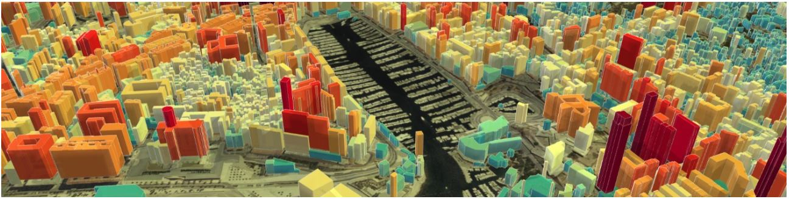

.. cv documentation master file, created by
   sphinx-quickstart on Sun May  8 12:20:35 2022.
   You can adapt this file completely to your liking, but it should at least
   contain the root `toctree` directive.

Miguel Narvaez
==============

Ingénieur Géomaticien
#############################################

.. toctree::
   :maxdepth: 2

   experience.md
   skills.md
   education.md

.. note ::
   Télécharger le CV :download:`MiguelNarvaez.pdf 📥📁 <./CV_Miguel_Narvaez.pdf>`
